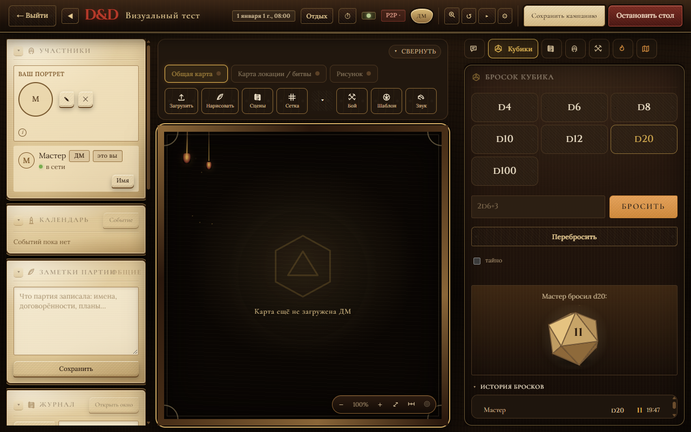

# D&D Table на Rust

Виртуальный стол для D&D 5e: мастер поднимает сервер прямо в приложении, игроки
подключаются по ссылке-билету через P2P — без VPN, проброса портов и отдельного
хостинга.

Этот репозиторий — Rust-порт [ArtVemka/dnd-table](https://github.com/ArtVemka/dnd-table)
(Electron + Node + чистый JS). Веб-слой переиспользован без переписывания,
сервер и оболочка заменены на Rust. Связь с источником сохранена и в поведении:
тот же протокол Socket.IO, те же JSON-поля, тот же формат кампаний, поэтому
старые кампании открываются сразу.



## Что умеет

**Стол и карта**
- карты с сеткой, туманом войны, светом и стенами;
- фишки с портретами, размером и здоровьем, шаблоны заклинаний;
- инициатива, порядок боя, HUD партии;
- общая и личная карта, рисунок поверх карты.

**Персонажи и контент**
- листы персонажей, статблоки, бестиарий;
- импорт приключений из Foundry VTT (JSON и ZIP);
- кампании с автосохранением, резервными копиями, экспортом и восстановлением;
- справочник НИПов и заметки партии.

**Кубики и общение**
- формулы вида `2d6+3`, быстрые кнопки, скрытые броски;
- объёмные кубики на canvas: подбрасывание, отскок, трение и выпавшая грань
  всегда развёрнута к игроку;
- история бросков, чат, шёпот, команды `/r`, `/w`, `/hp`, `/ac`, `/vote`;
- саундборд и эмбиент: громкость, зацикливание, загрузка своих файлов
  (MP3, OGG, WAV, M4A, WEBM, FLAC до 32 МБ).

**Оформление**
- шесть тем: «Стандартная», «Лес», «Магия», «Океан», «Трактир», «Стимпанк»;
- общий стиль — тёмный дубовый стол, пергаментные панели и золочёные рамки;
- плавные анимации, которые отключаются системной настройкой «уменьшить
  движение» и переключателем в приложении.

**Десктоп**
- трей, сворачивание в трей, одно окно на запуск, запоминание положения окна;
- Discord Rich Presence (необязательно);
- автообновление установленной версии;
- Windows: портативная сборка, установщик NSIS, MSI; Linux: AppImage и deb.

## Как это работает

```
┌──────────────────────────── Tauri 2 ────────────────────────────┐
│  окно WebView2 / WebKitGTK                                      │
│    renderer/  HTML + CSS + JS, тот же, что в Electron-версии    │
│         │ invoke (window.desktop)      │ Socket.IO (игроки)     │
│         ▼                              ▼                         │
│  Rust-оболочка                  axum + socketioxide             │
│  окно, трей, кампании,          игровое состояние, 130 событий  │
│  iroh, Discord, обновления      раздача renderer/ и /files/     │
└─────────────────────────────────────────────────────────────────┘
```

- **Один процесс.** HTTP-сервер и Socket.IO живут внутри приложения на
  `127.0.0.1`. Порт — первый свободный начиная с 32100. Мастер открывает окно
  и уже хостит стол.
- **P2P через iroh.** Мастер создаёт билет, игрок вставляет его или сканирует
  QR. Трафик игрока туннелируется к локальному серверу мастера, поэтому не
  нужны ни белый IP, ни проброс портов. В LAN можно подключаться и напрямую по
  адресу.
- **Совместимый контракт.** 130 событий Socket.IO, camelCase-поля и
  `/files/<name>` для картинок и звука — ровно то, что ждёт `renderer/`.
  Поэтому веб-слой не пришлось переписывать.
- **Данные.** Установленная версия хранит кампании в `%APPDATA%\dnd-table`
  (Linux — `~/.config/dnd-table`). Портативная — в `data\` рядом с exe.
  Переменная `DND_DATA` переопределяет каталог. Формат кампаний совместим с
  Electron-версией.
- **Обновления.** Подписанные сборки и `latest.json` в GitHub Releases.
  Приложение проверяет наличие новой версии при запуске, установка —
  в Настройках → Обновления. Установщик заменяет только файлы приложения;
  кампании, копии и загруженные файлы остаются на месте.

## Установка

Готовые сборки — в [Releases](https://github.com/ArtVemka/DnD-vtt-rust/releases).

- **Windows, установщик:** `DnD.Table_..._x64-setup.exe` (NSIS) или `.msi`.
- **Windows, портативно:** распаковать `DnD-Table-portable.zip` и запустить
  `DnD Table.exe`. Данные будут лежать в `data\` рядом.
- **Linux:** AppImage (сделать исполняемым и запустить) или `.deb`
  (`sudo apt install ./DnD.Table_..._amd64.deb`).

Установленная версия обновляется сама. Портативную обновляют заменой файлов.

## Сборка из исходников

Нужны Rust stable и WebView2 (на Windows 10/11 уже есть). Node нужен только
для запуска Tauri CLI, если он не установлен глобально.

```powershell
# Windows
$env:Path = "$env:USERPROFILE\.cargo\bin;$env:Path"
cargo run -p dnd-desktop                     # окно с рендерером
npx --yes @tauri-apps/cli@2 build            # MSI и NSIS в target\release\bundle
powershell -File tools\portable.ps1          # dist\DnD-Table-portable.zip
```

```bash
# Linux: зависимости сборки (Debian/Ubuntu)
sudo apt install build-essential curl wget file patchelf \
  libwebkit2gtk-4.1-dev libayatana-appindicator3-dev librsvg2-dev \
  libxdo-dev libssl-dev
cd crates/dnd-desktop
npx --yes @tauri-apps/cli@2 build            # AppImage и deb
```

Запуск сервера без окна (полезно для отладки рендерера в браузере):

```powershell
cargo run -p dnd-server                      # печатает LISTENING 127.0.0.1:<port>
```

## Структура

```
crates/dnd-core       модель, правила, кубики, хранилище кампаний
crates/dnd-server     axum + socketioxide, состояние стола, раздача renderer/
crates/dnd-desktop    Tauri 2: окно, трей, мост window.desktop, iroh, Discord
crates/dnd-importer   импорт приключений Foundry VTT
renderer/             веб-слой, общий с Electron-версией
fixtures/             эталонные данные, снятые с JS-реализации
tools/                сборка портативной версии, скриншоты, проверки
docs/                 контракт Socket.IO и заметки по порту
```

## Чем отличается от Electron-версии

- Нет Node.js в рантайме: один нативный процесс и один exe.
- Сервер на Rust (axum + socketioxide) вместо Node, тот же протокол для клиента.
- Нативные трей, одноэкземплярный запуск, запоминание окна и автообновление.
- Объёмные кубики с физикой на canvas вместо плоских граней.
- Сборки под Linux, которых у Electron-версии не было.
- Кампании и настройки переносятся без конвертации: общий каталог данных и
  формат.

## Ограничения

- Android остаётся WebView-обёрткой вокруг того же рендерера и в этот
  репозиторий не входит.
- Поиск по Open5e не перенесён: кнопки в интерфейсе скрыты.
- d100 рисуется кубом: отдельной геометрии на 100 граней нет.
- Автообновление не предлагается портативной сборке — её обновляют вручную.

## Лицензия

MIT.
